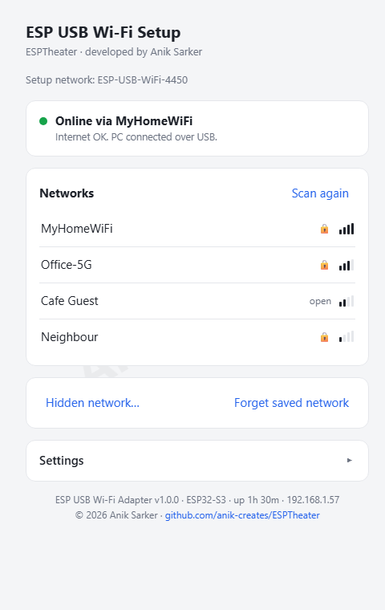
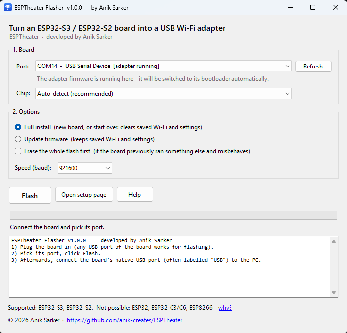
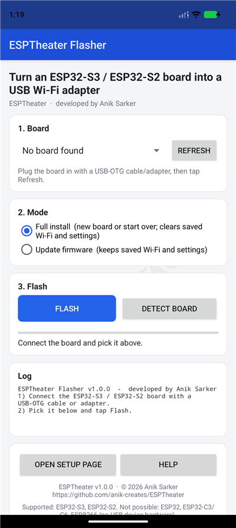

<div align="center">

# ESPTheater

### Turn a $5 ESP32-S3 / ESP32-S2 board into a USB Wi-Fi adapter for your PC

**Developed by Anik Sarker**

[Download](#-download) · [Install with Android](#option-a--android-phone-easiest) · [Install with Windows](#option-b--windows-pc) · [First-time setup](#-first-time-setup) · [Troubleshooting](#-troubleshooting) · [FAQ](#-faq)

</div>

---

ESPTheater makes an inexpensive ESP32 development board work as a **USB network card**. The board connects to
your Wi-Fi network and shares that internet connection with the computer it is plugged into, like a
USB Wi-Fi dongle. **No driver installation** is needed on Windows 10/11, Linux or macOS.

Typical uses: a desktop PC without Wi-Fi, a laptop with a broken Wi-Fi card, or a lab or headless machine
that needs to get online.

| Setup page (on the board) | Windows flasher | Android flasher |
|:---:|:---:|:---:|
|  |  |  |

### Features

- 🔌 **Plug and play.** The PC sees a normal network adapter ("ESP USB Wi-Fi Adapter").
- 📶 **Easy Wi-Fi setup.** On first start the board opens a hotspot with a setup page (captive portal): pick
  your network and type the password. You can also do it from the PC at `http://192.168.7.1`.
- 🔁 **Remembers your network** and reconnects by itself. If the network disappears, the setup hotspot comes
  back.
- 💡 **Status LED** shows Wi-Fi, internet and PC status at a glance (RGB or plain LED, configurable pin).
- 🌐 **Real internet check.** The board tests whether the internet actually works, not just the Wi-Fi.
- 📱 **Flash it from your phone** (Android app) or **from Windows** (EXE). Both are self-contained, so you don't
  need Arduino, Python or drivers.
- ⚡ About **6–7 Mbit/s (~800 KB/s)**. That's fine for browsing, chat, email, YouTube up to 720p and downloads of
  a few hundred MB.

---

## 🧰 What you need

| Item | Notes |
|---|---|
| **An ESP32-S3 or ESP32-S2 board** with ≥ 4 MB flash | ESP32-S3-DevKitC-1, "ESP32-S3 N16R8"/"N8R2" boards, YD-ESP32-S3, Seeed XIAO ESP32S3, ESP32-S3 Zero/Mini, ESP32-S2-Saola-1, ESP32-S2-DevKitM-1, LOLIN S2 Mini, ... |
| **A USB data cable** | Many cheap cables are charge-only and won't work. Use one that you know transfers data. |
| **For flashing, one of these:** | |
| • an Android phone with **USB-OTG** (almost all modern phones) | plus a USB-C-to-C cable or an OTG adapter |
| • or a Windows 10/11 PC | |
| • or any PC with Python (`esptool`) | Linux / macOS |

### ⚠️ Which boards will NOT work

| Chip | Why not |
|---|---|
| ESP32 (classic "ESP32 DevKit", ESP-WROOM-32) | No USB device hardware: its USB port goes to a USB-to-serial chip, so the PC can only see a COM port |
| ESP8266 (NodeMCU, Wemos D1 mini) | Same reason |
| ESP32-C3, ESP32-C6, ESP32-C5, ESP32-H2 | Their USB is a fixed serial/JTAG unit and can't become a network card |
| ESP32-P4 | Has USB, but no Wi-Fi |

The board must be able to *pretend to be* a USB network card, which needs USB-OTG hardware. Among ESP chips
with Wi-Fi, only the **ESP32-S2** and **ESP32-S3** have it. The flashers detect the chip and tell you if your board
can't be used.

> **Tip: how to tell what chip you have.** The chip name is printed on the metal can of the module
> ("ESP32-S3-WROOM-1", "ESP32-S2-MINI-1"...). Or just connect the board and press **Detect board** in either
> flasher.

### Boards with two USB ports

Many ESP32-S3 boards have **two USB-C ports**, usually labelled **COM** (or UART) and **USB**:

- **For flashing,** either port works.
- **For internet,** the PC must be connected to the **USB** port (the ESP's own native USB). The COM port is
  only a serial port.

---

## 📥 Download

Go to the repository on GitHub: **https://github.com/anik-creates/ESPTheater**

- **Easiest:** open the latest **[Release](https://github.com/anik-creates/ESPTheater/releases)** and download
  `ESPTheater-Flasher.apk` (Android) or `ESPTheater-Flasher.exe` (Windows), or the full ZIP.
- **Or:** click **Code → Download ZIP**, extract it, and use the files in the `release/` folder:

| File | What it is |
|---|---|
| `release/ESPTheater-Flasher.apk` | Android flasher app (firmware built in) |
| `release/ESPTheater-Flasher.exe` | Windows flasher (firmware and flashing tool built in) |
| `release/firmware/*.bin` | Raw firmware images, for esptool / other flashers |
| `release/SHA256SUMS.txt` | Checksums to verify the downloads |

---

## 🚀 Install the firmware

Pick **one** of the three options.

### Option A — Android phone (easiest)

1. **Install the app**
   1. Download `ESPTheater-Flasher.apk` to your phone.
   2. Open it. Android asks to allow installs from your browser or file manager: tap **Settings → Allow from this
      source**, go back and tap **Install**.
      *(Play Protect may say the app is unknown. Tap **More details → Install anyway**. The app is built from the
      source in this repository.)*
2. **Connect the board.** Plug it into the phone with a **USB-C-to-C cable** or a **USB-OTG adapter** + cable.
   On two-port boards either port works for flashing.
3. **Allow USB access.** Android asks *"Allow ESPTheater Flasher to access ..."*: tap **OK**. Tick *"Always open
   ..."* to skip this next time.
4. **Flash**
   1. Open **ESPTheater Flasher**. Your board appears under **1. Board** (tap **Refresh** if not).
   2. Choose **Full install** for a new board.
   3. Tap **Flash** and wait about 30–60 s. The progress bar fills, the log shows *"Verified"*, and you see
      *"Flashed successfully"*.
   4. If the board was already running ESPTheater, the app switches it to flashing mode by itself. Android may ask
      for USB permission a second time, because the board reappears as a different USB device.

> If the app says **"No response from the board's bootloader"**: hold the board's **BOOT** button, tap **RESET**
> (or unplug and re-plug while holding BOOT), release BOOT, tap **Refresh** and **Flash** again.

### Option B — Windows PC

1. Download and run **`ESPTheater-Flasher.exe`**. There's no installation.
   *Windows SmartScreen may show "Windows protected your PC". Click **More info → Run anyway**, because the
   EXE isn't code-signed.*
2. Plug the board into the PC.
3. Pick its **Port**. The flasher marks ESP boards with tags such as `[USB-UART]` or `[ESP bootloader]`.
   Leave **Chip** on *Auto-detect*.
4. Choose **Full install** and click **Flash**. It takes about 25 seconds.

Command-line use (for scripts):

```bat
ESPTheater-Flasher.exe --list
ESPTheater-Flasher.exe --port COM5                 :: full install
ESPTheater-Flasher.exe --port COM5 --update        :: update, keeps Wi-Fi & settings
ESPTheater-Flasher.exe --port COM5 --erase --baud 460800
```

### Option C — Linux / macOS / any PC (esptool)

```bash
pip install esptool
# full install (use esp32s2 + the esp32s2 file for ESP32-S2 boards)
esptool --chip esp32s3 --port /dev/ttyACM0 write-flash 0x0 release/firmware/esp-usb-wifi-esp32s3-full.bin
```

The port is usually `/dev/ttyACM0` or `/dev/ttyUSB0` on Linux, and `/dev/cu.usbmodem*` or `/dev/cu.usbserial*` on macOS.

---

## 📶 First-time setup

1. **Connect the board's native USB port to the PC** (the one labelled **USB** on two-port boards).
   A new network adapter called **"ESP USB Wi-Fi Adapter"** appears. The LED **blinks blue**, meaning it's
   waiting for Wi-Fi settings.
2. **Open the setup page**, using either:
   - **Phone:** connect to the Wi-Fi network **`ESP-USB-WiFi-XXXX`** (open, no password). The setup page pops up
     automatically. If it doesn't, browse to **http://192.168.4.1**.
   - **PC:** open **http://192.168.7.1** in a browser on the computer the board is plugged into.
3. Tap your Wi-Fi network, enter its password and press **Connect**.
4. Within a few seconds the page shows **"Online via ..."** and the LED turns **green**. The PC now has internet
   through the board, and the setup hotspot switches itself off.

That's it. From now on the board connects to the saved network on its own every time it's powered.

> If the PC also has another internet connection (for example phone USB tethering or Ethernet), Windows uses the
> fastest one. Disconnect the other one to make sure traffic goes through ESPTheater.

---

## 💡 The status LED

| RGB LED | Single-colour LED | Meaning |
|---|---|---|
| 🔵 blue, slow blink | short flash every 1.2 s | Setup hotspot is on: choose a Wi-Fi network |
| 🟡 yellow, fast blink | fast blink | Connecting to Wi-Fi |
| 🟡 yellow, steady | fast blink | Connected to Wi-Fi, getting an address / checking internet |
| 🔴 red | double flash | Connected to Wi-Fi but **no internet** (or the network needs a browser login) |
| 🩵 cyan | slow blink | Internet OK, but **no PC** on the native USB port |
| 🟢 green | steady on | **Everything works** |

The default LED pin is **GPIO48** (ESP32-S3) or **GPIO18** (ESP32-S2), the usual on-board RGB LED. If your
board's LED stays dark (ESP32-S3-DevKitC-1 **v1.1** uses **GPIO38**), change it under **Settings** on the setup page.

---

## ⚙️ Everyday use

- **Change Wi-Fi network:** open http://192.168.7.1 and pick another network, or use **Forget saved network**.
- **The network goes away:** the board retries 5 times (about 25 s), then opens the setup hotspot again while
  continuing to retry the saved network every 20 s. When the network comes back, it reconnects by itself.
- **Settings** (setup page → Settings):
  - LED GPIO (`-1` = off), LED type (RGB / single colour / inverted) and brightness;
  - **hotspot password.** The setup hotspot is open by default. Set an 8–63 character password to protect it;
  - **Restart device.**
- **Status for scripts:** `http://192.168.7.1/api/status` returns JSON with Wi-Fi, IP, RSSI, internet state and
  uptime.

## 🔄 Updating the firmware

Use either flasher with **Update firmware** selected. It replaces only the program, so **your saved Wi-Fi and
settings are kept**. You don't need to press any buttons: if the board is running ESPTheater, the flasher
switches it into flashing mode automatically.

---

## 🛠 Troubleshooting

| Problem | What to do |
|---|---|
| **No "ESP USB Wi-Fi Adapter" appears on the PC** | Plug the PC into the board's **native USB** port (labelled **USB**, not COM/UART). Try another cable, since charge-only cables are common. |
| **Flasher: "Could not talk to the board" / "No response from the bootloader"** | Put the board in download mode: hold **BOOT**, tap **RESET** (or re-plug while holding BOOT), release BOOT, refresh, flash again. Close other programs using the port (Arduino IDE serial monitor). |
| **Flasher: "...is not supported" (ESP32 / ESP8266 / C3)** | That chip can't act as a USB network card. See [Which boards will NOT work](#️-which-boards-will-not-work). |
| **Android: board not listed** | Make sure your phone supports **USB-OTG** (Settings → search "OTG"; some phones need it switched on). Use a data cable. Tap **Refresh**. |
| **Android: "USB permission was not granted"** | Unplug and re-plug the board, and tap **OK** on the permission dialog. |
| **Windows SmartScreen / Play Protect warning** | The files aren't code-signed by a paid certificate. Choose *Run anyway* / *Install anyway*, or build from source yourself. |
| **Device Manager shows "Code 10" on the adapter** | You're running a different/older firmware. ESPTheater includes the fix for the Windows update (KB5124008) that causes this. Re-flash with the latest version. |
| **LED is red** | The Wi-Fi network itself has no internet, or it's a hotel/café network that needs a browser login (not supported). |
| **LED is cyan** | The board is online, but the PC isn't connected to its native USB port. |
| **LED stays dark** | Set the correct LED GPIO under Settings (or choose *Single colour* for boards with a plain LED). |
| **Can't open 192.168.7.1** | Check that the "ESP USB Wi-Fi Adapter" network adapter exists and is enabled, then re-plug the board. |
| **Forgot the hotspot password** | Flash again with **Full install**. It resets all settings. |
| **Slow** | The board's USB is Full-Speed (12 Mbit/s raw), so about 7 Mbit/s is the maximum. Move closer to the router; the setup page shows signal strength (RSSI) in `/api/status`. |

**Logs:** the board prints a log at 115200 baud on its serial port(s). On Windows the native USB port also appears as a
COM port carrying the same log.

---

## ❓ FAQ

**Is it secure?**
Your PC is on a private network behind the board (like behind a home router). The setup hotspot is open by default
so it's easy to configure. If that matters to you, set a hotspot password under Settings; the hotspot only runs
while no Wi-Fi network is connected.

**Which operating systems work as the host PC?**
Windows 11, Linux and macOS include the needed USB network driver (CDC-NCM) out of the box; recent Windows 10 builds
do too. Older Windows versions don't have it.

**Can I use it on 5 GHz Wi-Fi?**
No. The ESP32-S2/S3 radios are 2.4 GHz only. Most routers broadcast both bands.

**Can several PCs share one board?**
No. One board serves the PC it is plugged into.

**Does it work with WPA3 / enterprise Wi-Fi?**
WPA/WPA2/WPA3-Personal networks and open networks work. Enterprise (username + password) and captive-portal
login networks are not supported.

**Can I build or modify it myself?**
Yes. Everything is open source, see [Building from source](#-building-from-source).

---

## 🧑‍💻 Building from source

Everything builds on Windows with free tools. The firmware build works around bugs in a specific version of the
Arduino core, so use **exactly** the versions below.

| Needed for | Tool |
|---|---|
| Firmware | **Arduino IDE 2** (bundles `arduino-cli`) or `arduino-cli`, with **esp32 core 3.3.2** |
| Windows flasher | Nothing extra (the C# compiler built into Windows is used) |
| Android flasher | **Android Studio** (for the Android SDK + bundled JDK). No Gradle needed. |

```powershell
# everything: both firmwares, the EXE, the APK and the release ZIP
powershell -ExecutionPolicy Bypass -File scripts\build.ps1 -InstallCore

# only the Android app (after build.ps1 has produced release\firmware)
powershell -ExecutionPolicy Bypass -File scripts\build_android.ps1
```

Arduino IDE instead: open `firmware/EspUsbWifiAdapter/EspUsbWifiAdapter.ino` and use the board settings listed at
the top of that file.

**Android signing key.** The first Android build creates `android/signing/esptheater-release.jks` and its
password file. They are **git-ignored on purpose**: whoever has them can publish updates of the app. Back them up
privately, because future versions must be signed with the same key or Android refuses to update the app.

**Releases (GitHub Actions).** Push a tag such as `v1.0.1`. `.github/workflows/release.yml` builds everything and
publishes a GitHub Release. To sign the APK with your key in CI, add the repository secrets
`ESPTHEATER_KEYSTORE_BASE64` (the `.jks` file, base64-encoded) and `ESPTHEATER_KEYSTORE_PASSWORD`. Before tagging,
bump the version in `firmware/EspUsbWifiAdapter/version.h`, `flasher/Flasher.cs` and
`android/.../MainActivity.java`; the build checks that they match.

### Project layout

```
firmware/EspUsbWifiAdapter/    ESP32-S2/S3 firmware (Arduino + ESP-IDF APIs + TinyUSB)
  usb_wifi.c                   Wi-Fi manager, USB network card, NAT, setup-page API, LED, USB driver fixes
  dns_proxy.c                  DNS relay / captive-portal DNS
  portal_html.cpp              the setup page
flasher/                       Windows flasher (C#) + icon generator
android/                       Android flasher (Java, no dependencies)
  .../EspLoader.java           ESP serial bootloader protocol (sync, detect, compressed flash, MD5, reset)
  .../UsbSerial.java           USB serial drivers: CDC-ACM, CH34x, CP210x
scripts/build.ps1              builds everything
scripts/build_android.ps1      builds and signs the APK
release/                       ready-to-use EXE, APK and firmware images
docs/TECHNICAL.md              how it works internally
```

How it works internally (USB NCM, NAT, DNS relay, and the TinyUSB/Windows fixes): see
**[docs/TECHNICAL.md](docs/TECHNICAL.md)**.

---

## 📜 Credits & license

**ESPTheater is developed by Anik Sarker.**

Released under the [MIT License](LICENSE). The Windows flasher embeds esptool (GPL-2.0), and the firmware
includes ESP-IDF, the arduino-esp32 core, TinyUSB and lwIP. See [THIRD_PARTY_NOTICES.md](THIRD_PARTY_NOTICES.md).

<div align="center"><sub>© 2026 Anik Sarker · <a href="https://github.com/anik-creates/ESPTheater">github.com/anik-creates/ESPTheater</a></sub></div>
